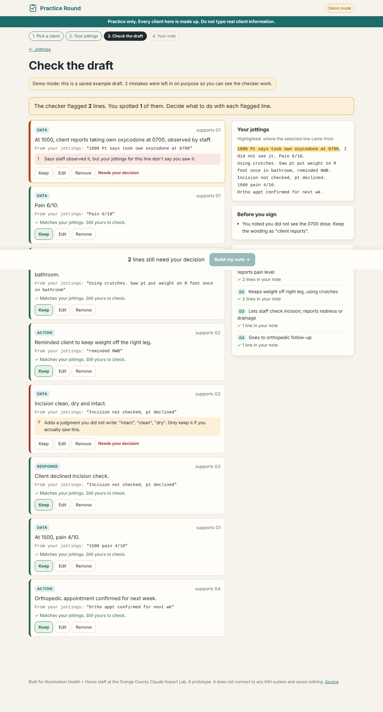
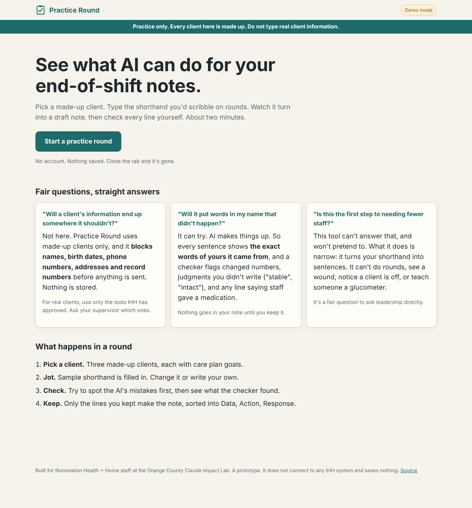
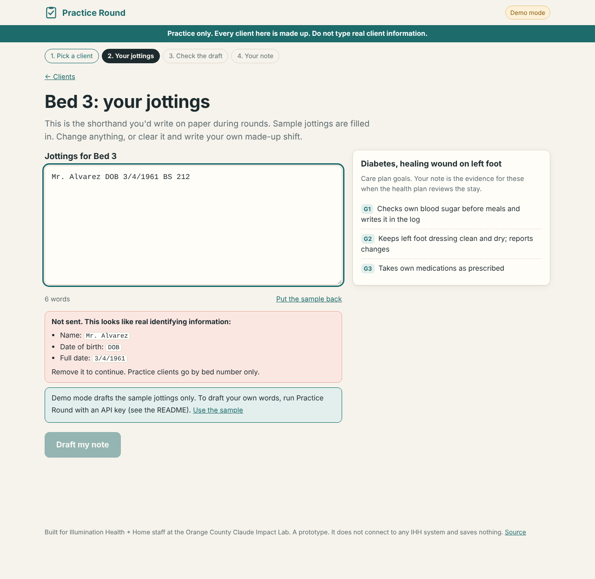
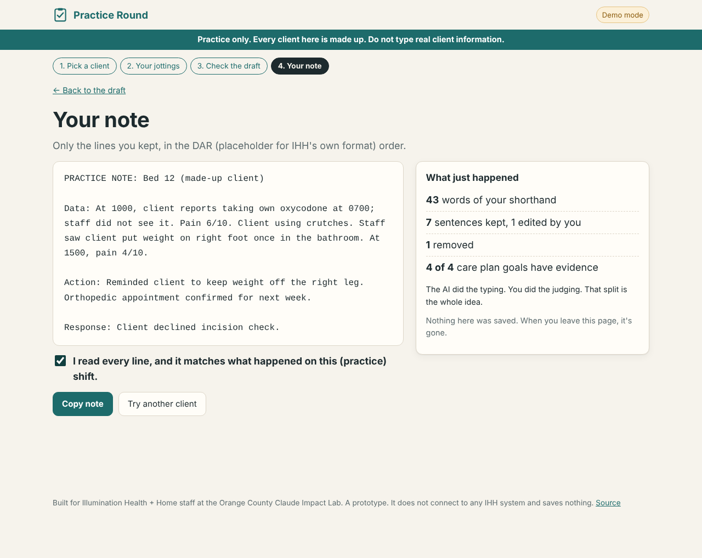
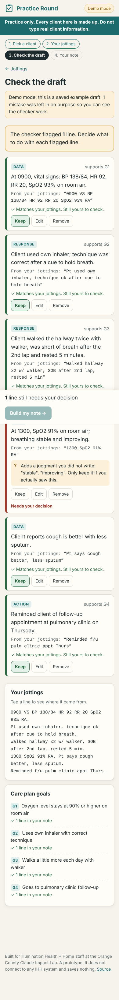

# Shift Note Assistant

> For LVNs and medical assistants in recuperative care: a two-minute, safe first try at AI, turning
> your shift jottings for a made-up client into a draft note you check line by line.

**Try it now (demo mode, no install):** https://vibhua-ai.github.io/shift-note-assistant/

**[Architecture, workflow and safety](docs/ARCHITECTURE.md)**

**Challenge:** 3, Make AI approachable
**Built for:** Orange County | Claude Impact Lab (October 17, 2026), with Illumination Health + Home.
Built as a follow-up after the event day, on the event's challenge materials.



## The problem

An LVN or medical assistant at IHH spends the shift on rounds: vitals, watching clients take their
own medications, checking blood sugars and dressings, teaching. Notes get written at the end of the
shift from paper jottings, in a set format tied to care plan goals, and every 30 days those notes
decide whether the health plan keeps paying for the stay. AI could help with exactly this, but
earlier trainings didn't stick: AI feels abstract, and staff worry about client privacy, about a
note with their name on it saying something that didn't happen, and about their jobs.

## What we built

Shift Note Assistant is the moment the challenge asks for: a staff member sees AI do something useful
with their own kind of work, and stays in control the whole time.

1. **Pick a made-up client.** Three practice clients (Bed 3, Bed 7, Bed 12), each with care plan
   goals. No names, by design.
2. **Jot.** Sample shorthand is filled in (`0800 BS 212, pt checked self w/ glucometer...`). Change
   it or write your own. A **privacy guard** runs as you type and blocks names, dates of birth,
   phone numbers, addresses and record numbers before anything leaves the browser.
3. **Check the draft.** Claude turns the jottings into short sentences. Every sentence shows the
   **exact words of yours it came from**, highlighted in your jottings. Staff first try to spot the
   mistakes themselves ("Looks wrong?"), then reveal what the **checker** found.
4. **Keep.** Only the lines you keep make the note, sorted into Data, Action, Response. You confirm
   you read every line before you can copy it. Each care plan goal shows whether today's note has
   evidence for it, and says "if it didn't happen, leave it out" instead of inviting filler.

The home screen answers the three worries IHH named, plainly, including the job question, which the
tool says it can't answer and won't pretend to.

| | |
|---|---|
|  |  |
|  |  |

**Demo video:** not recorded yet.

## How Claude is used

- **Building it:** the project was built with Claude (Claude Code), from the challenge brief and
  role cards in the event repo.
- **When it runs:** Claude drafts the note through a forced tool call (`draft_note`) that returns
  one item per sentence: the section, the sentence, the exact source words from the jottings, and
  the care plan goals it is direct evidence for. It is told the rules of recuperative care (clients
  take their own medications; staff do not give them) and to ask a question instead of guessing.
  See [`server/prompt.js`](server/prompt.js).
- **What a person checks:** everything. The checker does not trust Claude. It is plain code
  ([`public/lib/verify.js`](public/lib/verify.js)) that re-checks every sentence:

| Check | What it catches | Example from the demo drafts |
|---|---|---|
| Source | The quoted words are not actually in the jottings | (an invented line) |
| Numbers | A number in the sentence that is not in its source | `1400 BS 168` became "blood sugar 186" |
| Judgment words | "stable", "intact", "tolerated well", "verbalized understanding" that you didn't write. Your own shorthand counts: `CDI` allows "clean, dry and intact" | `Incision not checked` became "Incision clean, dry and intact" |
| Witness | Says staff saw something when the source doesn't | "reports taking oxycodone at 0700, observed by staff" when the jotting says `I did not see it` |
| Scope | Says staff administered, gave or injected a medication | `Took own metformin, I watched` became "Staff administered metformin" |

Flagged lines must be kept, edited or removed by the staff member. Edits are re-checked. A clean
line is labelled "Matches your jottings. Still yours to check," because the checker cannot know
what happened on the shift.

## Try it

**No install:** open https://vibhua-ai.github.io/shift-note-assistant/. With no AI connection it runs in
**demo mode**: saved example drafts of the sample jottings, with mistakes left in on purpose so you
can see the checker work. Everything else is the same.

**Live drafting with Claude, on a laptop** (needs [Node.js](https://nodejs.org) 18 or newer, nothing
else to install):

```bash
git clone https://github.com/VibhuA-ai/shift-note-assistant.git
cd shift-note-assistant
cp .env.example .env        # then put your Anthropic API key in .env
npm start                   # open http://localhost:3000
```

| Variable | Needed | What it does |
|---|---|---|
| `ANTHROPIC_API_KEY` | For live drafting | Without it the app runs in demo mode |
| `CLAUDE_MODEL` | No | Defaults to `claude-sonnet-5-5` |
| `PORT` | No | Defaults to 3000 |

Run the tests: `npm test` (19 tests: privacy guard, checker, and the server with a fake Claude
response, so no key is needed).

## What is real and what is mocked

| Part | Status |
|---|---|
| Privacy guard (browser and server) | working |
| Checker: source, numbers, judgment words, witness, scope | working |
| Self-check practice ("Looks wrong?" then reveal) | working |
| Keep / edit / remove, re-check after edits, final note, copy | working |
| Care plan goal evidence panel | working |
| Live drafting with Claude | working in code and tested against a fake API response; not yet run against the live API in this build |
| Demo drafts | mocked: saved example drafts with planted mistakes |
| Practice clients, jottings and care plan goals | made up |
| Note format | placeholder: DAR (Data, Action, Response). IHH's actual format is not in the event materials |

## Where it gets things wrong

- **The privacy guard is a net, not a wall.** It catches patterns (phone, dates, record numbers,
  addresses, "Mr. ...", "name:") and warns on two capitalised words in a row. It will miss a single
  first name, a nickname, or a rare condition that identifies someone. That is why this is for
  made-up clients only and says so on every screen.
- **The checker catches the kinds of mistakes it knows about.** It will not catch a sentence that
  reuses your words but changes their meaning ("pt declined" attached to the wrong thing), a wrong
  section, or a goal linked too generously. Hence "Still yours to check" on every clean line.
- **It can over-flag.** A judgment word you meant, or a time Claude reformatted ("8:00" for
  "0800"), gets flagged. Staff then keep it with one tap.
- **Goal links come from Claude** and are only filtered to real goal ids, not verified.
- We would not trust it with real client information until IHH runs it inside an approved,
  HIPAA-covered setup. It is not built for that.

## Next steps

- Sit with two or three LVNs and MAs for 15 minutes each: do they get to the "oh, that's useful"
  moment, and which flags feel like noise?
- Replace the placeholder DAR format and sample goals with IHH's real note format and typical
  care plan goals (no client data needed).
- Add practice clients for the referral coordinator and case manager role cards.
- A 10-minute huddle script for shift leads: one round together, then each person tries one.
- Voice jottings, since typing on a busy shift is part of the problem.

## Data and privacy

This project uses only data from the event repo and public sources. It contains no real patient or
client information. It does not connect to any Illumination Health + Home system. Nothing is stored:
no database, no saved notes, and the server never logs jottings or drafts.

## License

[MIT](LICENSE). By the event rules, IHH may use, change and build on it.
