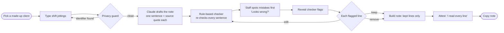
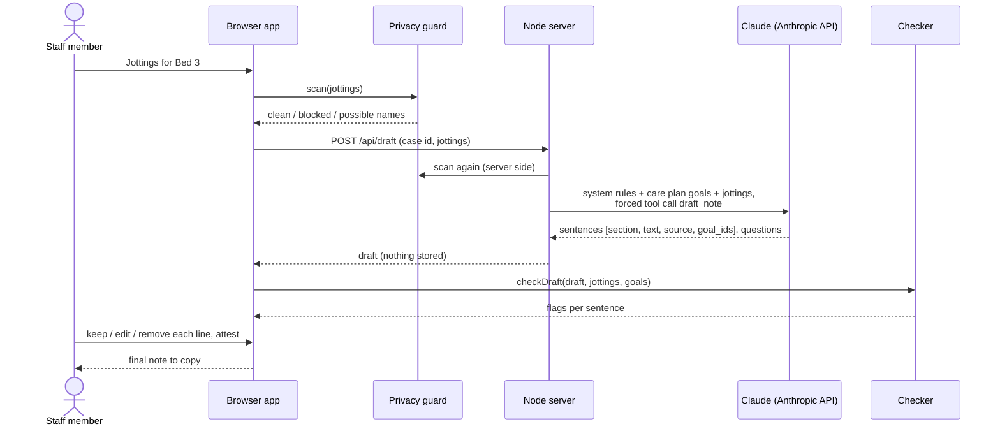
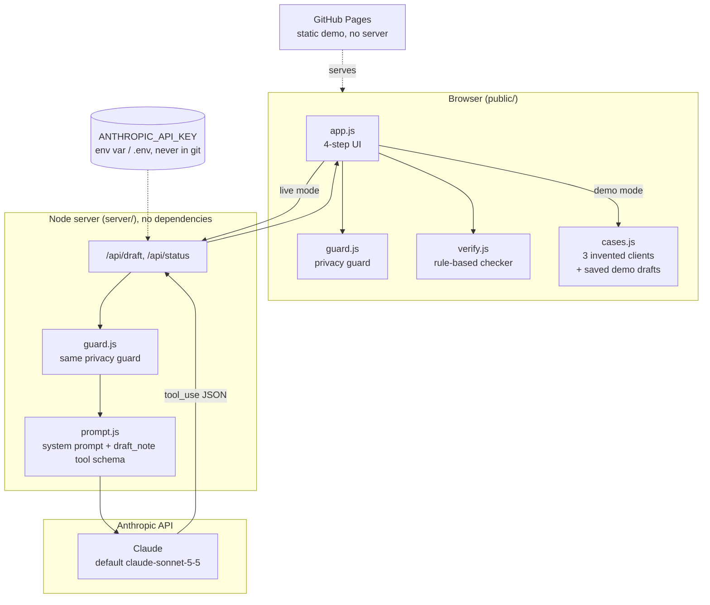
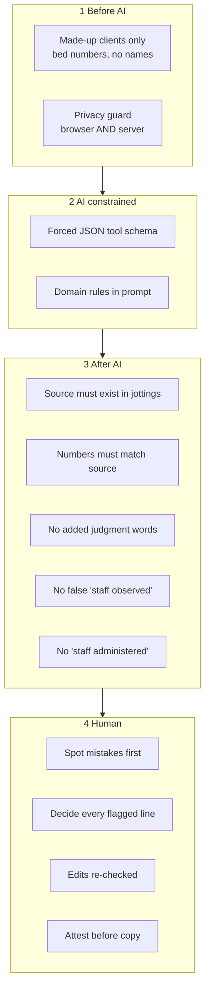

# Shift Note Assistant: architecture, workflow and safety

**Challenge 3: Make AI approachable.** For licensed vocational nurses (LVNs) and medical assistants
in recuperative care at Illumination Health + Home (IHH).

## 1. High level

Shift notes are written at the end of a busy shift from paper jottings, and every 30 days those
notes decide whether the health plan keeps paying for a client's stay. Earlier AI trainings didn't
stick: AI felt abstract, and staff worried about privacy, about notes saying things that didn't
happen, and about their jobs.

Shift Note Assistant is a two-minute, safe first try. A staff member picks a **made-up** client,
types the shorthand they would jot on rounds, and gets a draft note in which **every sentence is
tied to their own words**. A rule-based checker flags anything the jottings don't support, and
nothing goes in the note until the staff member keeps it.

| | |
|---|---|
| **User** | LVN or medical assistant, no AI experience assumed |
| **Input** | Free-text shift jottings for one of three invented clients (Bed 3, 7, 12) |
| **Output** | A draft progress note (Data, Action, Response) the staff member has checked line by line |
| **AI** | Claude drafts sentences; plain code checks them; a person decides |
| **Runs** | GitHub Pages (demo mode, no AI) or a laptop with Node.js (live Claude drafting) |

## 2. Workflow

## 3. Architecture

**Where AI is used, and where it isn't**

| Component | Technology | AI? |
|---|---|---|
| Drafting sentences | Claude via the Messages API, forced tool call `draft_note` with a JSON schema | **Yes, LLM** |
| Privacy guard | Regular expressions (phone, SSN, email, dates, DOB, MRN, long IDs, addresses, "Mr./Ms.", "name:") plus a two-capitalised-words name heuristic | No |
| Checker | Deterministic rules in `verify.js` | No |
| Final decision on every line | The staff member | Human |

## 4. How it was implemented

- **Built with Claude (Claude Code)** from the event's challenge brief and LVN role card, after the
  event day.
- **Zero-dependency stack:** vanilla JavaScript modules in the browser, a plain Node 18+ HTTP server,
  no build step. The same `guard.js` file runs in the browser and on the server.
- **Structured LLM output:** Claude must answer through one tool (`draft_note`) whose schema
  requires, for every sentence, the section, the text, the **exact source words** copied from the
  jottings and the care-plan goal IDs it is evidence for. Free-form prose is never accepted.
- **The prompt encodes the domain:** in recuperative care clients take their own medications, so
  staff never "administer"; keep every number exactly; never add judgments ("stable", "intact");
  write "client reports" when staff didn't see it; ask a question instead of guessing.
- **Demo mode:** without an API key, saved drafts with deliberately planted mistakes show the
  checker catching them, so the public site needs no AI service or secret.
- **Tests:** 19 Node tests cover the guard, every checker rule, the planted mistakes, and the server
  with a fake Claude response. GitHub Actions runs them before every Pages deploy.

## 5. Governance and safety

| Risk named by IHH | Control in the tool |
|---|---|
| Client information going where it shouldn't | Practice clients only; identifiers blocked before sending (browser and server); nothing stored, no database, server never logs jottings or drafts; banner on every screen; staff told to use only IHH-approved tools for real clients |
| A note in my name that says something that didn't happen | Every sentence shows its source; checker flags invented sources, changed numbers, added judgments, false witnessing, "administered"; flagged lines can't be skipped; edits re-checked; attestation required before copy; clean lines still say "Still yours to check" |
| Fewer staff | Stated openly on the home screen: the tool can't answer that; it only turns shorthand into sentences and can't do rounds, see a wound or teach |
| AI scope creep | No medical advice in prompts or questions; recuperative-care scope rule built into prompt and checker |
| Secrets | API key only in an environment variable or git-ignored `.env`; never sent to the browser |
| Event rules | No connection to any IHH system; no messages sent; MIT license; open source |

**Known limits.** The privacy guard is a pattern net, not a guarantee (a single first name or a rare
condition can slip through), which is why real client information is out of scope. The checker
only catches the kinds of mistakes it knows about. Goal links come from Claude and are filtered to
real goal IDs but not verified. Live drafting is tested against a fake API response, not yet against
the live API.
